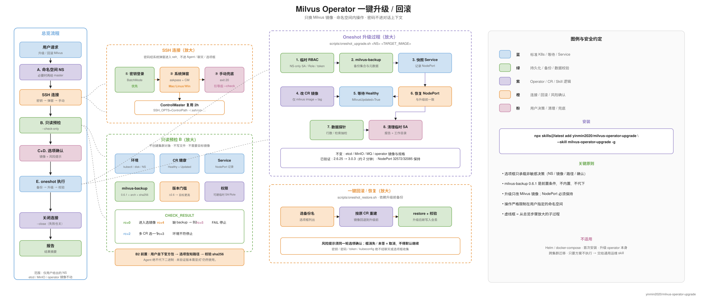

# milvus-operator-upgrade

给 Coding Agent（Cursor / Codex / Claude Code 等）用的 Skill：在 **milvus-operator** 部署的 Milvus 上，一键原地升级（只换 Milvus 镜像），或升级后一键回滚。



## 安装

需要 Node.js ≥ 22.20：

```bash
npx skills@latest add yinmin2020/milvus-operator-upgrade \
  --skill milvus-operator-upgrade -g
```

装到当前项目（不加 `-g`）也可以。无 Node 时：

```bash
git clone https://github.com/yinmin2020/milvus-operator-upgrade.git
cp -R milvus-operator-upgrade/skills/milvus-operator-upgrade ~/.agents/skills/
```

更新：`npx skills@latest update`

## 什么时候用

对 Agent 说类似：「把这个集群的 Milvus 升到 3.0」「用 operator 升级 Milvus」「回滚刚才的升级」。

**适用**：命名空间里有 `Milvus` CR（`kubectl get milvus -n <NS>` 有结果），并且要**真正执行**升级或回滚。

**别用这个 Skill**：Helm / docker-compose 部署、首次安装、升级 milvus-operator 本身、跨集群迁移，或只要方案不执行。

## Agent 会怎么做

1. 问命名空间（必要时再问 master SSH 地址）
2. SSH：密钥 → 系统密码弹窗 → 手动兜底（密码不进聊天）
3. 只读预检；缺 `milvus-backup` 0.6.1 时给出官方下载链接，由你放置并告知路径（**Agent 不代下**）
4. 选项选目标镜像 → 选项确认风险 → 自动备份 / 改镜像 / 校验 / 清理
5. 始终关闭 SSH 复用连接

升级**只改 Milvus 镜像**；etcd、MinIO、operator 不动；NodePort 保持；操作只发生在你给的命名空间。

**开启了鉴权（`authorizationEnabled=true`）**：备份/恢复始终带 `milvus-backup --rbac`，用户、角色、授权会一起备份并在回滚时恢复；需要在 master 的环境变量 `MILVUS_TOKEN=user:password`（root/admin）提供凭据（或 `MILVUS_TOKEN_FILE`，600 权限文件），**不要发到聊天里**。升级/恢复前后会比较 RBAC 快照，不一致会以退出码 14（部分）结束，不报告成功；旧备份没有 RBAC 时恢复前会让你选择“取消 / 仅恢复数据”。可选 `--rbac-test` 用一个应用用户验证“允许的操作成功、禁止的操作被拒”。详见 SKILL.md 的「Milvus 鉴权与 RBAC」。

已验证：`2.6.25 → 3.0.3` 与回滚。细节见 [`skills/milvus-operator-upgrade/SKILL.md`](./skills/milvus-operator-upgrade/SKILL.md)。

## License

MIT
